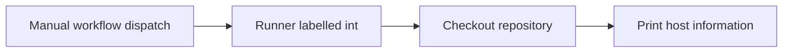

# GitHub Actions · self-hosted runner lab

A Flask greeting app on port **3000**, paired with a GitHub Actions exercise.





## Run the app locally

```bash
python3 -m pip install -r requirements.txt
python3 app.py
```

Open [localhost:3000](http://localhost:3000).

## Workflow behavior

The active workflow is manual-only and requires an available runner labelled `int`. It prints a greeting and `uname -a`. The Docker publishing example is commented out.

| File | Purpose |
| --- | --- |
| [app.py](app.py) | Flask route for GET /. |
| [test_app.py](test_app.py) | Application test source. |
| [Dockerfile](Dockerfile) | Container definition. |
| [.github/workflows/docker-publish.yml](.github/workflows/docker-publish.yml) | Checked-in workflow. |
